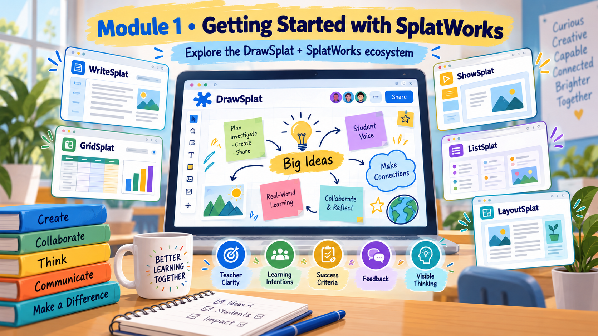
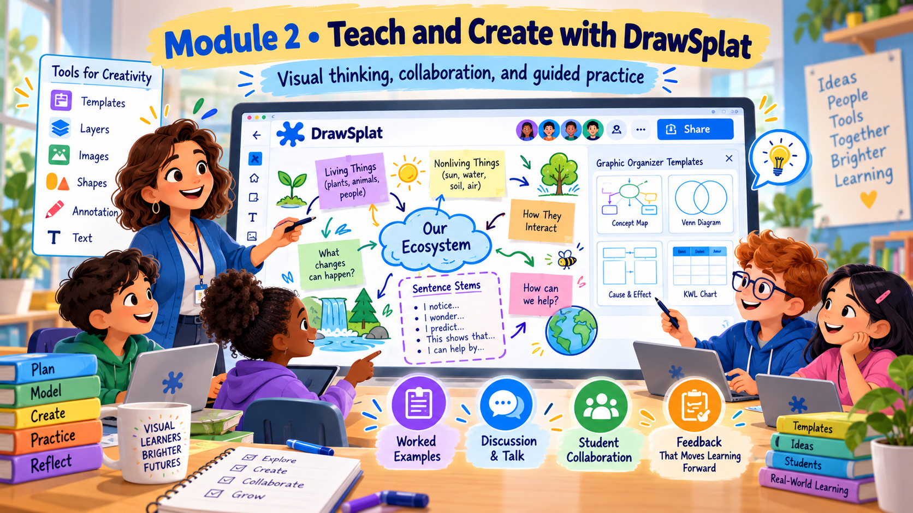
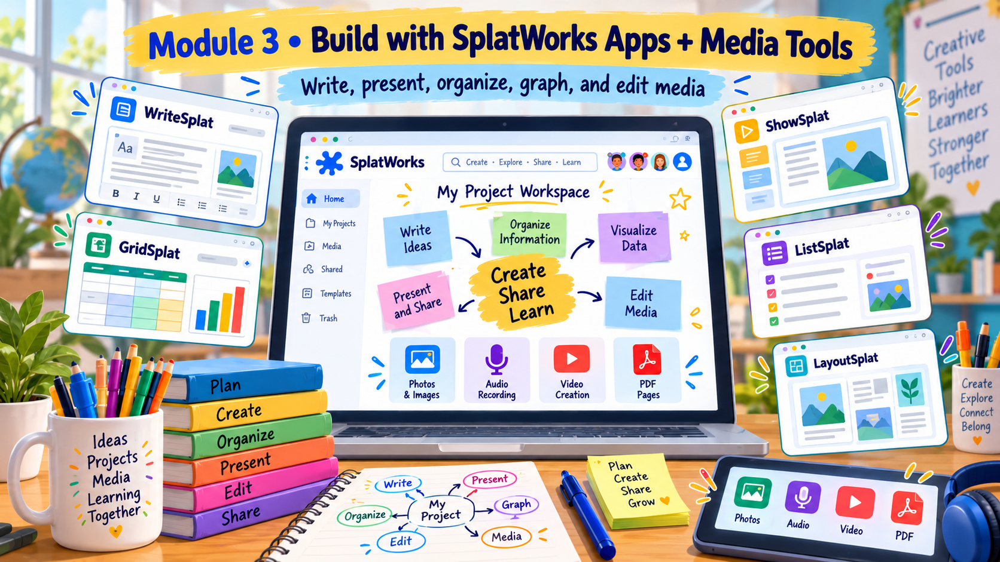
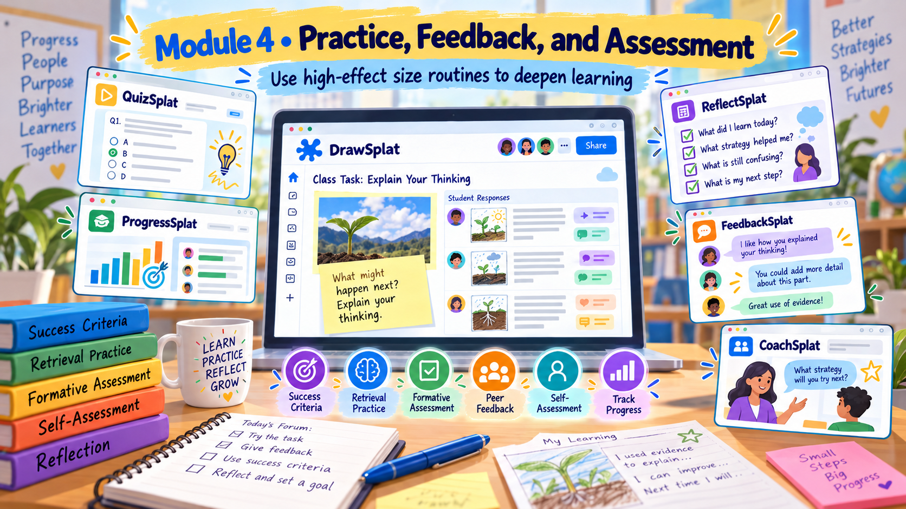
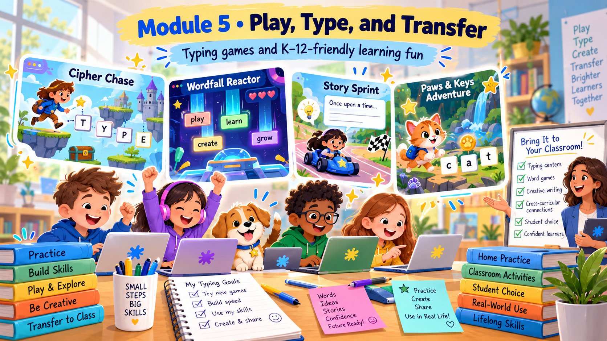

---

title: SplatWorks Educator

slug: splatworks-educator

tagline: Create, teach, assess and play with evidence-informed K–12 learning routines.

tags: SplatWorks, DrawSplat, K-12, Instructional design, Media literacy

badge: badge.png

about: Build a classroom-ready learning experience with the SplatWorks ecosystem, five modules, twenty narrated mini-lessons and practical evidence-informed activities.

---

# Module 1: Getting Started with SplatWorks

## 1.0 About the Module

This is professional learning for K–12 teachers, librarians, coaches and instructional leaders. You will build a small classroom learning experience across five modules. Use a laptop or Chromebook with a current browser, headphones if helpful, and permission to download files. A microphone is optional. You can complete the activities without student accounts or identifiable student work.

SplatWorks is the whole ecosystem: the DrawSplat whiteboard, five office applications, the PlanSplat planner, standalone tools, media editors, classroom utilities and games. The live Studio registry reviewed on October 31, 2026 lists 68 destinations. This course includes every registry destination in its linked field guide. Some tools deserve a full activity; others are useful options for a specific task.

Start with this transfer question: **What thinking should students do, and what evidence would show that they did it?** A compelling interface is helpful only when students use it to explain, retrieve, compare, practice or revise. The effect-size figures in this course describe research on instructional approaches, not measured effects of SplatWorks products. Estimates from different syntheses are not a league table, and they cannot be added together to predict learning gains.

Choose a real unit you teach. If you need a common example, use our fictional schoolyard inquiry: **Which place would keep a young plant cooler on a warm day, and what evidence supports the choice?** You will return to this example while learning the tools. Align a classroom adaptation to the standards already taught in your setting; the course does not assign a universal K–12 content standard.

Course completion includes 20 lesson sections and five quizzes. Each quiz requires 80%, with unlimited retries. The capstone is a self-checked product unless a facilitator configures an actual LMS assignment. Estimated study time is about five hours including practice and optional classroom transfer, not approved credit. CPE and GT hours remain zero until an authorized provider assigns them.

### Learning goals

- I can distinguish the SplatWorks ecosystem from the DrawSplat whiteboard and locate a tool for a specific learning task.

- I can write a learning intention and two observable success criteria before choosing software.

- I can save an editable project and a shareable export, reopen a copy, and explain domain-specific browser storage.

- I can use a plan–monitor–evaluate routine with a planner or a simple checklist.

Estimated time: 50 minutes. Rate each goal before and after: 1 new; 2 explain; 3 apply; 4 teach/adapt.

## 1.1 Explore

### Start with learning, then choose the tool

@video local:media/videos/m01-v01.mp4

@resource [Full transcript](media/transcripts/m01-v01.html) Text alternative.

### One ecosystem, many purposeful choices
Welcome to SplatWorks Educator. Start with a lesson you already teach. Before you open an app, name what students should think about and what you will collect as evidence. SplatWorks is the ecosystem; DrawSplat is the whiteboard within it. Studio lets you search for a task such as making a chart, explaining an idea or practicing vocabulary. This course includes a field guide to all sixty-eight current destinations, but your lesson only needs the tools that serve its purpose.

### Make success visible
Our common example asks which place would suit a young plant on a warm day. The intention is to recommend a location using observations. Success means naming a location and supporting it with two relevant observations. A colorful board does not meet those criteria by itself. Ask what the learner will say, draw or write that makes the reasoning inspectable. Use this same question when you choose a tool for your own subject.

### Pause and choose
Pause the video and locate DrawSplat, PlanSplat and one unfamiliar tool in Studio. Write one sentence describing the learning task each could support. Choose the smallest toolchain that fits the goal. Remember that research estimates about instructional strategies are not measured effects of these apps. The teacher still designs the modeling, practice, feedback and transfer task. Return when you have a goal, two criteria and a reason for your first tool choice.

### Save, reopen and protect the learning

@video local:media/videos/m01-v02.mp4

@resource [Full transcript](media/transcripts/m01-v02.html) Text alternative.

### Two files, two purposes
A dependable saving routine is part of lesson design. An editable project keeps the objects, records or timeline available for revision. A shareable export gives someone a view or finished product. They serve different purposes. Before class, save a small project and export it in a format the app supports. Reopen the editable file and inspect the export. That quick test is more useful than assuming that the download succeeded.

### Browser storage has boundaries
Browser drafts are tied to the device, browser and site origin. A draft on DrawSplat dot org is not automatically the same draft on SplatWorks dot org. Clearing browser data can remove local recovery information. Google Drive connections and district whiteboard accounts also have different roles; they do not make every app a shared cloud document. Follow the app guide, check the saved status and use exported files when moving work between contexts.

### Practice a recovery
Use anonymous practice content while you learn. Save a file with the course name, activity and version in the filename. Close the project, reopen the copy and check one important detail. Record where you will store the source and finished export. Finally, write a one-sentence fallback for the learning task. If a device or connection fails, students can still predict, examine evidence and revise a claim on paper.

### Plan, monitor and evaluate with a short routine

@video local:media/videos/m01-v03.mp4

@resource [Full transcript](media/transcripts/m01-v03.html) Text alternative.

### Plan the thinking
A planner is useful when it supports a thinking routine. Name a specific outcome, such as writing a claim supported by two observations. Break the work into actions that a learner can begin. PlanSplat can organize assignments and study time. Brain Sort can turn a task dump into a checklist, Step-Splat can divide a large task and Clock Wizard can help estimate phases. A paper checklist is a valid alternative.

### Monitor while working
During the work block, pause to compare the developing product with the criteria. Ask: have I named the location, included the evidence and explained the connection? A timer tells you that time passed; it does not tell you whether the explanation improved. Model the self-questioning aloud. If evidence is missing, change the next action instead of simply adding more decorative features.

### Evaluate and schedule a revisit
After the task, identify one improvement and the strategy that produced it. Schedule a later opportunity to explain the idea without the original scaffold. This makes the plan more than a list of due dates. Pause now and create two short work blocks for your course artifact, plus a later review. Keep the goal and criteria beside the schedule so that the plan remains connected to the learning.

## 1.2 Practice On Your Own

Choose one content goal from a current unit. Write an intention in student language and two criteria describing the quality of the thinking, not the appearance of the file. For our example: “I can recommend a location for a plant using observations.” Criteria: name a location and support it with two relevant observations.

1. Open Studio and locate DrawSplat, PlanSplat and a tool you have never used. Record the learning task each could support.
2. In DrawSplat, create three panels: **Predict**, **Notice evidence**, and **Revise**. Put one question on each and model a brief answer on a separate example.
3. In PlanSplat, or the supplied planning worksheet, schedule two short work blocks and a later review. Use Brain Sort for a task dump, Step-Splat to divide the deliverable, or Clock Wizard to estimate the time.
4. Export an editable project with a clear filename and a shareable image or document where supported. Reopen the editable copy and confirm it contains your work. Browser autosave alone is not your backup.
5. Add a single “If the technology fails…” sentence. A paper prediction–evidence–revision organizer is a workable fallback.

**Deliverable:** a three-panel launch plus a one-page plan naming the goal, criteria, learner actions, save routine and fallback.

**Self-check:** a colleague should be able to state the learning goal without seeing the app name; each panel should require a different step in thinking; your downloaded editable file should reopen.

**Reflect:** What will you look for in student responses that would cause you to change tomorrow’s instruction?

@video local:media/videos/m01-v04.mp4

### Classroom adaptation

### Hook: 5 minutes
Teacher: Display two possible plant locations. Ask which is better without supplying the answer.
Students: Students make an initial prediction individually by drawing, writing or speaking.

### Model: 8 minutes
Teacher: Name the goal and criteria. Think aloud about one observation from a different example.
Students: Students explain which criterion the example meets and what evidence is still missing.

### Guided practice: 8 minutes
Teacher: Co-construct one evidence statement on the board.
Students: Pairs complete a second statement using an observation they can point to.

### Independent application: 12 minutes
Teacher: Give each learner a fresh prediction–evidence–revision organizer.
Students: Students choose a location, cite two observations and revise their initial prediction if needed.

### Closure: 7 minutes
Teacher: Collect an individual explanation and sort responses by the missing reasoning.
Students: Students name one change they made and one question for the next lesson.

### Differentiation

- Support: supply two observation cards and a three-box organizer; allow oral explanation or teacher scribing.

- Extend: ask learners to propose a competing explanation and an observation that would discriminate between the claims.

- Language: preview shade, observation and evidence with pictures; use “I recommend … because I observed …”.

## 1.3 Resources and Knowledge Check

@resource [All 68 destinations: ecosystem field guide](media/resources/ecosystem-field-guide.html) Course resource.

@resource [Research and effect-size notes](media/resources/evidence-notes.html) Course resource.

@resource [Learning design worksheet](media/resources/learning-design-worksheet.html) Course resource.

@resource [Feedback samples and revision task](media/resources/feedback-practice.html) Course resource.

@resource [Capstone self-check](media/resources/capstone-checklist.html) Course resource.

@resource [K–12 game selection and access guide](media/resources/game-selection-guide.html) Course resource.

@resource [Fictional schoolyard observations dataset (CSV)](media/resources/schoolyard-observations.csv) Course resource.

@quiz

pass: 80

shuffle: true

Q: A teacher wants students to explain how two observations support a claim. What should come first?

- Choose the app with the most animations

- *Name the intended thinking and evidence of success

- Promise a fixed effect size for the lesson

- Require every student to use all 68 tools

feedback: Begin with the learning intention and success criteria; then choose a tool that makes that thinking visible.

Q: Which statement accurately describes the ecosystem?

- *SplatWorks is the ecosystem; DrawSplat is its whiteboard

- DrawSplat and PlanSplat are the same application

- Every tool requires a district student account

- SplatWorks consists only of spreadsheets

feedback: SplatWorks includes the whiteboard, office applications, planner, standalone tools, utilities and games.

Q: Which saving routine best protects an editable project?

- Keep only a screenshot

- Assume autosave follows the student to every domain

- *Export an editable copy, reopen it, and keep a shareable export when needed

- Clear browser storage to force a backup

feedback: A reopened editable export verifies that the work can be recovered. A screenshot is useful for viewing but may not preserve editable objects.

Q: A chart reports teacher clarity at 0.85. What can you responsibly infer?

- Any SplatWorks lesson will improve scores by 85%

- All clarity studies measured this software

- The estimate should be added to every other strategy estimate

- *It summarizes a research influence, not a guaranteed gain from an app

feedback: An effect size is not a percentage score gain or a product result. Context and the underlying study designs matter.

Q: Which is a plan–monitor–evaluate routine?

- *Set a goal, check the evidence while working, and revise the next step

- Pick a random app every day

- Complete a checklist without examining the work

- Time students but never discuss a strategy

feedback: Self-regulation includes planning, monitoring progress and evaluating what to change; a timer or planner only supports that routine.

@endquiz

# Module 2: Teach and Create with DrawSplat

## 2.0 About the Module

A whiteboard becomes instructional when the arrangement of objects reveals relationships and students explain their choices. In this module, build a three-stage worked-example sequence: a complete model, a partly completed task and a new independent problem. Show your reasoning before asking novices to invent a procedure.

Use DrawSplat’s pen, text, shapes, sticky notes, images and panels for the smallest usable task. A background template can provide structure. Advanced tools include connectors, comments, audio notes and richer organization; availability depends on the current mode and school setup. Simple mode can reduce the number of controls facing young learners. Before class, test the functions your particular activity needs.

For our plant inquiry, place **Sunlight**, **Surface temperature** and **Water loss** on a board. Connect the ideas and label each arrow with a relationship that a learner can defend. An arrow without a label can conceal a weak connection. A prompt such as “Why would this observation support that claim?” makes the reasoning visible.

ConceptSplat is suited to visual relationships; DiagramSplat uses text syntax for structured diagrams. A diagram is not automatically an assessment: ask each learner to explain one connection in a new context. Group work needs a shared product and contributions from every learner. Assign a builder, an evidence checker and an explainer, then rotate the roles. When live collaboration is not configured, use one shared display with turn-taking or exchange exported files.

Create purposeful assets with ImageSplat, BackdropSplat, FontSplat, GIFsplat, Draw & Sketch, Coloring Book or MemeSplat. Use a picture to explain a relationship, not merely fill a corner. Describe the visual in text, keep contrast high, and avoid conveying meaning only through color. SketchSplat VR is an optional immersive extension; a flat image or model must remain a usable alternative.

### Learning goals

- I can model a worked example on DrawSplat and gradually remove support.

- I can use labeled relationships, diagrams and self-explanation to reveal a misconception.

- I can structure roles and individual accountability in a collaborative activity.

- I can produce an accessible visual with a readable hierarchy and a text explanation.

Estimated time: 55 minutes. Rate each goal before and after: 1 new; 2 explain; 3 apply; 4 teach/adapt.

## 2.1 Explore

### Worked examples that reveal the reasoning

@video local:media/videos/m02-v01.mp4

@resource [Full transcript](media/transcripts/m02-v01.html) Text alternative.

### Show the why
A worked example is more than a finished answer. It makes the steps and reasons visible. Build a complete model, then a partially supported example, then a fresh independent task. For the plant inquiry, demonstrate how one observation supports a location choice and name the uncertainty. Say why you use that observation rather than simply describing which object you clicked.

### Remove support deliberately
Duplicate the model’s useful structure and remove one step that learners are ready to supply. You might keep the claim and observations but remove the explanation. Ask a partner to complete it and justify the choice. Avoid removing every support at once for a novice. Listen for the misconception before offering the answer; the learner’s explanation tells you which part needs another model.

### Check a new case
The final task should change the example while preserving the reasoning demand. A student who can copy the original answer has not necessarily transferred the idea. Give a new observation and ask for a new explanation. Use one individual response to decide whether to move ahead, provide a smaller scaffold or reteach a connection. Pause and identify the step you will model, the step you will fade and the new case you will use.

### Concept maps, diagrams and purposeful visuals

@video local:media/videos/m02-v02.mp4

@resource [Full transcript](media/transcripts/m02-v02.html) Text alternative.

### Relationships need labels
Use ConceptSplat when the learner needs to arrange ideas and explain relationships. Use DiagramSplat when a structured diagram written in text syntax fits the task. In either case, an unlabeled arrow can hide weak thinking. Connect sunlight, surface temperature and water loss with words that describe the relationship. Ask why the connection is reasonable and what evidence would challenge it.

### Create assets that explain
ImageSplat can annotate and adjust an image; BackdropSplat can remove a background. FontSplat can create lettering and compositions. GIFsplat can show a short sequence, and MemeSplat can combine a caption with an image. Choose an asset because it clarifies the idea. A diagram or animation still needs a text explanation. Use descriptive labels, high contrast and a readable size, and avoid making color the only carrier of meaning.

### Pause and explain a connection
Create one small asset for your lesson. Explain in a sentence what the learner should notice and why it supports the goal. Test whether the explanation still makes sense without the color cues. Draw and Sketch or Coloring Book may be enough for a simple response. SketchSplat VR is an optional extension, with a flat alternative for learners who cannot or prefer not to use an immersive view.

### Collaboration with roles and individual evidence

@video local:media/videos/m02-v03.mp4

@resource [Full transcript](media/transcripts/m02-v03.html) Text alternative.

### A shared screen is a starting point
Effective group work needs more than a shared screen. Give the group a common outcome and roles that rotate: a builder arranges the claim, an evidence checker challenges the support and an explainer justifies the connection. Everyone should have a meaningful contribution. When live collaboration is unavailable, use turn-taking at one display or exchange saved copies without pretending the files are simultaneously shared.

### Teach the talk
Model useful questions before asking students to collaborate. Ask which observation supports the claim, what alternative explanation might fit and what would change their mind. Give learners time to rehearse a response. Watch whether a confident student is making every decision. Adjust the roles or the task so that quieter learners also explain something important.

### Close with individual evidence
End the activity with an individual explanation or a new connection. That evidence helps distinguish a strong group product from each learner’s understanding. Invite students to identify one revision that came from the discussion. Pause and add role cards, two discussion questions and one individual exit prompt to your board plan. Judge the quality of the reasoning rather than how much artwork the group produces.

## 2.2 Practice On Your Own

Create a three-panel task for one misconception you regularly encounter. Suggested example: students treat “more sunlight” as always meaning “better for every plant” without considering heat or water.

1. Build a complete model with two observations, a labeled connection and a short explanation of why the evidence supports the claim. Think aloud about an alternative explanation.
2. Duplicate the structure. Remove one observation or one explanation step; learners will complete it with a partner.
3. Create an independent case with different observations. Require a fresh explanation rather than a copied sentence.
4. Make one visual asset in a creation tool. For example, annotate an image in ImageSplat or create a simple concept map in ConceptSplat. Keep a text equivalent beside it.
5. Rehearse a role rotation: builder places a claim, checker challenges its evidence, explainer justifies one connection. Every learner writes or records a final individual explanation.
6. Save and reopen the editable board and the asset. Record the chosen tool’s role in the reasoning.

**Deliverable:** three learning panels, one purposeful visual and a 60-second teacher think-aloud script.

**Self-check:** the model explains why, the partially completed example has a useful scaffold, the independent task is genuinely new, and a learner can respond without relying on color or hearing.

**Reflect:** Which student connection would reveal the misconception most clearly? What question would you ask before offering the answer?

@video local:media/videos/m02-v04.mp4

### Classroom adaptation

### Hook: 4 minutes
Teacher: Display a plausible but incomplete concept map. Ask which arrow is hardest to defend.
Students: Students identify a weak connection independently.

### Model: 10 minutes
Teacher: Build one labeled relationship and explain why the observation supports it.
Students: Students restate the reasoning using their own words.

### Guided practice: 10 minutes
Teacher: Provide a map with one missing link and assign rotating roles.
Students: Groups complete the link; each member explains a different part.

### Independent application: 10 minutes
Teacher: Give a new observation and remove the map scaffold.
Students: Each learner builds a small explanation with evidence.

### Closure: 6 minutes
Teacher: Compare two explanations against the criteria without ranking the artwork.
Students: Students revise one connection and describe the reason for the revision.

### Differentiation

- Support: supply movable concept cards and two possible relationship verbs; model a shorter example before releasing the task.

- Extend: require a counterexample or a competing causal map and identify evidence that would favor one model.

- Language: offer the frames “This increases … because …” and “This observation does not show …”; allow rehearsal before writing.

## 2.3 Resources and Knowledge Check

@resource [All 68 destinations: ecosystem field guide](media/resources/ecosystem-field-guide.html) Course resource.

@resource [Research and effect-size notes](media/resources/evidence-notes.html) Course resource.

@resource [Learning design worksheet](media/resources/learning-design-worksheet.html) Course resource.

@resource [Feedback samples and revision task](media/resources/feedback-practice.html) Course resource.

@resource [Capstone self-check](media/resources/capstone-checklist.html) Course resource.

@resource [K–12 game selection and access guide](media/resources/game-selection-guide.html) Course resource.

@resource [Fictional schoolyard observations dataset (CSV)](media/resources/schoolyard-observations.csv) Course resource.

@quiz

pass: 80

shuffle: true

Q: Which board best supports self-explanation?

- A page filled with decorative stickers

- A color-coded list with no question

- *A map with labeled links and a prompt asking why the evidence supports the claim

- A screenshot learners copy exactly

feedback: Self-explanation requires learners to make and justify relationships; visual decoration and copying do not establish that reasoning.

Q: How should a novice worked-example sequence develop?

- *Complete model, partly completed example, then a new independent problem

- Independent problem first, followed only by a score

- Remove all explanation from every example

- Show the same finished answer three times

feedback: Model the reasoning, gradually remove support and check transfer with a fresh task.

Q: Three learners share one device. Which design provides individual accountability?

- Let the fastest learner make every decision

- Grade only how colorful the shared map is

- Give everyone the same unchanging role

- *Rotate roles and collect a final explanation from each learner

feedback: A shared product needs structured participation and individual evidence of learning.

Q: A visual uses green for evidence and red for claims. What should be added?

- More shades of red

- *Text labels or other cues plus a meaningful text explanation

- A requirement to hear the teacher’s explanation

- A smaller font to fit everything

feedback: Labels and text alternatives keep the meaning available to learners who cannot distinguish colors or access the visual in the same way.

Q: Which is the best reason to use ConceptSplat or DiagramSplat?

- The tool guarantees improved test scores

- Every classroom task requires code syntax

- *The selected format helps learners represent and explain the needed relationships

- The tool eliminates the need to check misconceptions

feedback: Choose a diagram format because it supports the intended representation and explanation; assess the reasoning afterwards.

@endquiz

# Module 3: Build with SplatWorks Apps and Media Tools

## 3.0 About the Module

The office and media tools support different parts of the same learning cycle. WriteSplat develops a written explanation. ShowSplat makes a sequence for presenting it. GridSplat calculates and visualizes numerical evidence; ListSplat structures records. LayoutSplat designs a publication or ebook. PlanSplat organizes the work over time. A learner might use two of these well rather than open all of them in one lesson.

Use the supplied fictional **Schoolyard observations** dataset. Four records describe locations, temperature and notes from one imagined observation period. They exist only for practice: they are not measurements from a real school and cannot establish that shade caused a temperature change. ListSplat can store the records; GridSplat or GraphSplat can compare the values. Ask what else would need to be observed before a strong claim is justified.

Write a claim–evidence–reasoning paragraph, then turn it into three ShowSplat slides: a question, evidence and a recommendation with a limitation. In LayoutSplat, adapt it into a one-page field guide or short ebook. MarkdownSplat is a useful route for structured source text. PDFsplat can annotate a source, organize pages or present a PDF. Check an exported file rather than assuming every import or conversion preserves the original layout.

Media tools differ by task. ClipSplat records/imports clips and combines illustrated panels or image cards with cuts. VideoSplat offers timeline editing, named markers, captions and privacy tools. MediaSplat splits, trims or joins audio/video. AudioSplat records and edits multitrack audio. GIFsplat, explored in module 2, creates short visual sequences; reserve motion for something that benefits from motion.

The included course videos are optional narrated visual overviews with synthetic English narration, real screenshots and explanatory slides. They are not live recordings of a person manipulating the apps. Their captions and full transcripts are supplied locally. Follow the linked app while working, pause often, and use the text alternative whenever that is easier.

### Learning goals

- I can select among WriteSplat, ShowSplat, GridSplat, ListSplat, LayoutSplat and PlanSplat for a defined purpose.

- I can organize records and chart a small dataset without overstating what the data show.

- I can explain when ClipSplat, VideoSplat, MediaSplat and AudioSplat solve different production needs.

- I can create a short accessible explanation with a source file, export, transcript and checked captions.

Estimated time: 65 minutes. Rate each goal before and after: 1 new; 2 explain; 3 apply; 4 teach/adapt.

## 3.1 Explore

### From written explanation to publication

@video local:media/videos/m03-v01.mp4

@resource [Full transcript](media/transcripts/m03-v01.html) Text alternative.

### Choose the form after the purpose
Start with the explanation you want students to construct. WriteSplat helps develop and format the text. ShowSplat sequences an explanation for presentation. LayoutSplat designs a publication or ebook. These are different communication forms, not a checklist that every learner must complete. PlanSplat can organize the work, and MarkdownSplat can preserve structured source text when that format is useful.

### One claim, three useful moments
For our common example, draft a short claim, cite two observations and explain a limitation. A three-slide version can show the question, evidence and recommendation. A one-page guide can use the same reasoning with a chart and text summary. Avoid copying a dense paragraph onto every slide. Give the audience one clear purpose for each visual moment.

### Keep source and export
Keep the editable source as well as the finished export. Import and export conversions may change layout, fonts or other features, so inspect the resulting file. PDFsplat can help annotate, organize or present a PDF when that suits the lesson. Before you share, check the reading sequence, image descriptions and whether the document still communicates the main reasoning without your narration.

### Organize and graph evidence without overclaiming

@video local:media/videos/m03-v02.mp4

@resource [Full transcript](media/transcripts/m03-v02.html) Text alternative.

### Records and calculations serve different needs
ListSplat organizes fields and records. GridSplat works with numerical tables, formulas and charts. GraphSplat offers chart and graph-focused tools, including picture and coordinate representations. Choose the representation that helps learners answer the question. A list of records and a chart can support the same inquiry, but they make different features easier to inspect.

### Read the sample honestly
Open the supplied schoolyard observations file. It contains four fictional records for practice, not measurements from a real school. Read the units and notes before charting. You can describe the pattern in these records, but you cannot claim that the sample proves a general cause. Ask what other conditions, repeat observations or comparisons would be needed for a stronger conclusion.

### Make the chart inspectable
Build a clearly titled chart with labeled units. Write a text summary that cites two values and one limitation. Ask a partner to check the values against the table. The chart’s job is to support a defensible explanation, not merely look polished. Pause and make a small chart, then write a recommendation that separates the observations from the inference.

### Choose an accessible media workflow

@video local:media/videos/m03-v03.mp4

@resource [Full transcript](media/transcripts/m03-v03.html) Text alternative.

### Match the editor to the job
Choose the media route by the editing job. ClipSplat can record or import clips, add illustrated panels or image cards and cut sections. VideoSplat provides richer timeline work, named markers, captions and privacy tools. MediaSplat is useful for splitting, trimming and joining audio or video. AudioSplat records and edits multitrack audio. You may need only one or two of these tools for a short classroom explanation.

### Script before recording
Write the script before recording. Name the intended audience and keep the claim, evidence and limitation easy to follow. A chart should remain readable in the exported frame. Use media you are allowed to reuse and avoid identifiable student information during practice. An equivalent slide-and-text response can meet the learning goal when recording is not accessible or appropriate.

### Check access after export
After export, inspect captions for names, numbers and timing. Provide the transcript beside the video and describe visual evidence that the audio does not convey. Test the result with sound off and in another player if available. The course mini-lessons model a narrated slide format with local captions and transcripts; they are not live recordings of someone editing inside the apps.

## 3.2 Practice On Your Own

Use the supplied sample data or a non-sensitive dataset from your own curriculum. The practice target is a 45–75 second explanation for a specific audience, supported by a chart and a readable text alternative.

1. Open `schoolyard-observations.csv`. Identify the unit, the number of observations and one limitation. Import the data into GridSplat or GraphSplat and create a clearly titled comparison chart with labeled units.
2. In WriteSplat or MarkdownSplat, draft 100–140 words: a recommendation, two numerical observations, the reasoning and one uncertainty. Compare your text against the criteria before recording.
3. Use ShowSplat to plan three visual moments. Include a chart or an annotated image, not a paragraph copied onto a slide. Save the editable source.
4. Choose a media route. Record narration in AudioSplat and assemble a visual explanation in ClipSplat or VideoSplat; use MediaSplat for straightforward trimming/joining. If recording is unavailable, produce a three-slide explanation with speaker notes and a written transcript.
5. Add or check captions when producing a video. Correct names, numbers and timing; automatic captions require human review. Remove identifying information and use only media you may reuse.
6. Export the explanation and test it on another player or browser. Save the project, the export, the caption file and the transcript together. Include your chart’s text summary.

**Deliverable:** a short explainer or equivalent slide-and-text response, its source file, the chart and an accessibility check.

**Self-check:** a viewer can identify the claim, verify the cited values and hear or read the limitation. The explanation remains usable without sound.

**Reflect:** What did you omit to reduce unnecessary processing? Which choice made the evidence easier to inspect?

@video local:media/videos/m03-v04.mp4

### Classroom adaptation

### Hook: 5 minutes
Teacher: Display two charts made from the same fictional observations, one missing units.
Students: Students identify which is easier to interpret and why.

### Model: 8 minutes
Teacher: Think aloud while converting one data value into a supported sentence.
Students: Students distinguish the observation from an inference.

### Guided practice: 10 minutes
Teacher: Build a short chart summary with the class and label a limitation.
Students: Pairs check the values and rehearse a sentence aloud.

### Production: 15 minutes
Teacher: Offer video, slides with notes or written/visual explanation as equivalent response routes.
Students: Students produce a concise explanation and check it against the same content criteria.

### Closure: 7 minutes
Teacher: Ask a partner to access the explanation with audio off.
Students: Students repair an access issue and submit an individual evidence statement.

### Differentiation

- Support: use a prepared chart, a storyboard and a sentence frame so the content reasoning remains attainable.

- Extend: compare the sample with a second observation period, identify a confound or explain why the sample cannot support a causal claim.

- Language: supply a bilingual key-word list where available and permit rehearsal or a first-language planning draft before the final response.

## 3.3 Resources and Knowledge Check

@resource [All 68 destinations: ecosystem field guide](media/resources/ecosystem-field-guide.html) Course resource.

@resource [Research and effect-size notes](media/resources/evidence-notes.html) Course resource.

@resource [Learning design worksheet](media/resources/learning-design-worksheet.html) Course resource.

@resource [Feedback samples and revision task](media/resources/feedback-practice.html) Course resource.

@resource [Capstone self-check](media/resources/capstone-checklist.html) Course resource.

@resource [K–12 game selection and access guide](media/resources/game-selection-guide.html) Course resource.

@resource [Fictional schoolyard observations dataset (CSV)](media/resources/schoolyard-observations.csv) Course resource.

@quiz

pass: 80

shuffle: true

Q: A learner needs editable numerical calculations and a chart. Which is the most direct starting point?

- AudioSplat

- *GridSplat

- CipherSplat

- Paws & Keys Adventure

feedback: GridSplat supports spreadsheets, formulas and classroom charts; GraphSplat is another useful chart-focused option.

Q: Four fictional schoolyard records show lower temperatures in shade. What is the most responsible claim?

- *The sample illustrates a pattern, but cannot establish a general causal effect

- Shade always reduces temperatures by the same amount everywhere

- The dataset proves the app raises science achievement

- The sample can be described as real student research

feedback: The supplied data are fictional and small. Learners should separate the observed pattern from a causal or general claim.

Q: Which media choice best matches a simple split/trim/join task?

- ListSplat because it stores records

- RubricSplat because it scores criteria

- *MediaSplat because that is its direct editing role

- A word search because it uses vocabulary

feedback: MediaSplat focuses on splitting, trimming and joining media; VideoSplat is a richer timeline-editing option.

Q: What must happen before treating automatic captions as ready to share?

- Assume they are correct if the video plays

- Delete the transcript

- Speed up the narration

- *Check words, numbers and timing against the actual media

feedback: Caption accuracy and timing need review, especially for technical terms and numerical evidence.

Q: Why keep the project file as well as the exported video or document?

- *To preserve editable structure for later revision

- To claim the export cannot ever fail

- To replace every accessibility check

- To avoid explaining the learning goal

feedback: The project preserves editable work; the export is the shareable view. Both should be checked and stored deliberately.

@endquiz

# Module 4: Practice, Feedback and Assessment

## 4.0 About the Module

Practice is most informative when it reveals what a learner can do without looking at the answer. Use a short retrieval prompt at the beginning of a lesson, corrective feedback after the attempt and a related prompt later in the week. Reusing the identical visible answer may build familiarity without establishing independent recall.

QuizSplat supports quizzes, flashcards and team activity formats. Choose a question that requires the intended thinking. For a flashcard, ask the learner to answer before revealing the reverse. For a team activity, have every learner commit to a response before the group discusses it. A team score can guide the energy of a session but cannot replace individual evidence.

RubricSplat can help define a few observable criteria for an explanation. For our inquiry, use evidence accuracy, reasoning and communication/access. Say what the work currently demonstrates and the next action that would improve it. Replace “Great job!” alone with “Your claim names a location; add the temperature values and explain why they support it.” Reserve time for the learner to act on that message.

Toneshifter and Vibe Check can support a discussion about the tone of feedback. Treat tool suggestions as suggestions; verify that meaning, accuracy and respect remain intact. Do not infer a student’s feelings, identity or intentions from a tone label.

Classroom utilities organize participation. Wheel Spinner and Fortune Wheel can select a prompt; Story Wheel can combine writing ideas. Dicebreakers can create discussion turns. Bingo tools and Word Search Maker can support vocabulary activity, but recognition should be followed by explanation or retrieval. Coin Flipper and Dice Roller can generate data for probability. Timers, random choices and attractive points are classroom supports, not evidence that learning occurred.

The supplied module illustration contains imagined labels such as ReflectSplat, ProgressSplat, FeedbackSplat and CoachSplat. These represent teaching routines in the artwork; they are not listed as actual products in the reviewed ecosystem. Use QuizSplat, RubricSplat, the whiteboard and your own feedback processes for the real activities.

### Learning goals

- I can distinguish retrieval practice, recognition, engagement and evidence of transfer.

- I can write a five-item low-stakes check with corrective feedback and a later revisit.

- I can use a concise rubric to give criterion-based feedback that leads to a visible revision.

- I can interpret classroom utility outputs without assuming they measure subject mastery.

Estimated time: 55 minutes. Rate each goal before and after: 1 new; 2 explain; 3 apply; 4 teach/adapt.

## 4.1 Explore

### Retrieval that goes beyond recognition

@video local:media/videos/m04-v01.mp4

@resource [Full transcript](media/transcripts/m04-v01.html) Text alternative.

### Try before you reveal
Retrieval practice begins with an attempt to bring knowledge to mind. Ask for a short explanation before showing the answer. Then reveal corrective feedback and revisit the idea later with a changed example. QuizSplat can support questions, flashcards and team activities, but the learning depends on the prompt and the attempt. A learner copying a displayed answer is doing a different task.

### Build a small aligned check
Build a five-item check tied to the module goal. Include two essential facts, two reasoning questions and one new-case application. Ask what an incorrect response would tell you to teach next. Avoid questions whose difficulty comes mainly from confusing wording. For flashcards, require an answer before turning the card over. For team play, let each learner commit a response before the discussion.

### Use the evidence
Use the responses to plan the next action. Provide a short explanation when students need it, not just a mark. Schedule a later retrieval opportunity in PlanSplat or your calendar. A team score can make a review energetic but may hide an individual misconception. Pause and write one question that checks reasoning and one follow-up question using a different example.

### Feedback that changes the next attempt

@video local:media/videos/m04-v02.mp4

@resource [Full transcript](media/transcripts/m04-v02.html) Text alternative.

### Name the criterion
Choose a few criteria that describe the quality of the learning. For our explanation, use evidence accuracy, reasoning and communication or access. RubricSplat can help organize the descriptors. Keep them observable. A criterion such as uses two accurate observations is easier to act on than a vague label such as excellent effort.

### Give a next action
Good feedback can identify a strength and a next action. Say: your claim names a location; add the two temperature values and explain why they support it. The learner can act on that message. Praise alone may feel encouraging but does not specify how to improve the explanation. Toneshifter or Vibe Check may support revision of a message, but the teacher must verify the meaning and respectful tone.

### Reserve a revision window
Feedback is incomplete as a classroom routine if students never use it. Reserve time for a revision, ask learners to highlight the changed reasoning and check whether the action improved the work. The research figure for high-information feedback is a subgroup estimate, not a promise about this app. Pause and turn one vague comment into a criterion-based action, then revise the sample answer yourself.

### Classroom utilities with a learning purpose

@video local:media/videos/m04-v03.mp4

@resource [Full transcript](media/transcripts/m04-v03.html) Text alternative.

### Organize participation
Wheel Spinner, Fortune Wheel, dice and Dicebreakers can organize prompts or turns. Bingo Caller, Bingo Card Generator and WebBingoMaker support bingo activity formats. Story Wheel can create a writing combination. Each tool needs a purposeful question around it. Ask every learner to think before the selected student responds, so a random turn does not become the only evidence you collect.

### Recognition is one step
A word search can help learners notice letter patterns, but finding a word does not establish its meaning. Follow with a definition, example or application. Coin Flipper and Dice Roller can generate probability observations; have students record outcomes and compare a prediction with the sample. A timer or scoreboard describes participation, not subject mastery.

### Choose a response rule
Before the activity, decide how you will respond to the evidence. An error in the underlying idea may need another worked example. A partially correct explanation may need targeted practice and feedback. A secure explanation may justify an extension. Pause and choose one utility, one aligned learner response and one decision you will make from that response.

## 4.2 Practice On Your Own

Build a small assessment cycle for the same goal used in earlier modules. Use QuizSplat or the supplied planning worksheet; a paper version is equally acceptable.

1. Write five prompts: two essential facts, two reasoning questions and one new-case application. For example, ask students to explain why a single temperature observation cannot establish a reliable trend.
2. Write corrective feedback for each. Include the reasoning and the next useful action, not just “incorrect”. Avoid tricky wording unrelated to the goal.
3. Use RubricSplat or the supplied criteria to define three criteria: accurate evidence, justified reasoning and accessible communication. Write what “ready”, “developing” and “revise” would look like for each.
4. Examine the supplied sample responses in `feedback-practice.html`. Give one strength and one specific next action. Revise the weaker answer yourself so that the action has a visible result.
5. Schedule a fresh retrieval prompt for two days later in PlanSplat. Change the example while retaining the learning demand.
6. Decide how you will respond to an error pattern: another worked example, a targeted small group or a different explanation. Record the decision rule before seeing the results.

**Deliverable:** five prompts with answers and feedback, a three-criterion scoring guide, an annotated revision and a follow-up plan.

**Self-check:** each question targets taught content; a learner can act on the feedback; the revision changes the reasoning, not merely the formatting.

**Reflect:** Which result would tell you to reteach rather than move ahead? Which result would justify an extension?

@video local:media/videos/m04-v04.mp4

### Classroom adaptation

### Retrieve: 5 minutes
Teacher: Ask two short questions without showing notes or answer choices.
Students: Students commit an individual response before discussion.

### Explain and check: 8 minutes
Teacher: Model the reasoning behind one answer and invite comparison.
Students: Students identify the step where their reasoning differed.

### Guided feedback: 10 minutes
Teacher: Use a shared sample to model one criterion-based next step.
Students: Pairs write feedback and verify that it names an action.

### Revise: 12 minutes
Teacher: Provide a new case and a visible revision window.
Students: Each student applies feedback and highlights the changed reasoning.

### Closure: 5 minutes
Teacher: Collect an exit explanation and schedule a later revisit.
Students: Students name the strategy they will reuse on the next example.

### Differentiation

- Support: reduce reading load and provide a small set of evidence cards while retaining the explanation demand.

- Extend: ask learners to diagnose a misleading claim and design a check that would reveal the misconception.

- Language: allow oral retrieval or a sketch before the written response; explicitly teach the vocabulary used in the question.

## 4.3 Resources and Knowledge Check

@resource [All 68 destinations: ecosystem field guide](media/resources/ecosystem-field-guide.html) Course resource.

@resource [Research and effect-size notes](media/resources/evidence-notes.html) Course resource.

@resource [Learning design worksheet](media/resources/learning-design-worksheet.html) Course resource.

@resource [Feedback samples and revision task](media/resources/feedback-practice.html) Course resource.

@resource [Capstone self-check](media/resources/capstone-checklist.html) Course resource.

@resource [K–12 game selection and access guide](media/resources/game-selection-guide.html) Course resource.

@resource [Fictional schoolyard observations dataset (CSV)](media/resources/schoolyard-observations.csv) Course resource.

@quiz

pass: 80

shuffle: true

Q: Which activity most clearly involves retrieval practice?

- Copying the answer from a visible flashcard

- Re-reading a definition silently

- Choosing the prettiest template

- *Attempting an explanation before revealing the answer

feedback: Retrieval requires an attempt to bring relevant knowledge to mind before consulting the answer.

Q: Which feedback is most actionable?

- *Add the two temperature values and explain how they support your location choice

- You are clever

- Try harder

- This is bad

feedback: The message identifies the missing evidence and a concrete reasoning action the learner can take.

Q: A team wins a QuizSplat review game. What should the teacher do to check individual learning?

- Assume every member mastered the goal

- Give everyone the winner’s score

- *Collect a fresh individual response aligned to the goal

- Remove all feedback from the next task

feedback: A team result can hide individual differences. A fresh aligned response supplies better evidence of each learner’s understanding.

Q: What does the feedback subgroup estimate d = 0.99 mean in this course?

- All digital feedback has that effect

- *One high-information subgroup in a particular meta-analysis had that estimate

- Students will gain 99 percentage points

- RubricSplat itself was tested at that value

feedback: The estimate belongs to a specific subgroup of feedback research and is not a measured product outcome or a percentage gain.

Q: A learner finds every target word in a word search. What follow-up best checks vocabulary meaning?

- Award subject mastery automatically

- Time a second word search only

- Ask which font they liked

- *Ask the learner to explain and apply several words in a new example

feedback: Finding letter patterns is different from knowing a word’s meaning and applying it; use an aligned explanation or application check.

@endquiz

# Module 5: Play, Type and Transfer

## 5.0 About the Module

Play can create a useful reason to practice, but the learning goal still determines the choice. The four typing experiences are different. Paws & Keys Adventure is designed for ages 4–9 with gentle progression. Story Sprint practices passages with speed, accuracy and character feedback and can import classroom text locally. Wordfall Reactor is a word-board activity with everyday words and optional subject vocabulary. Cipher Chase combines word typing with steering and arcade demands.

Start with a brief readiness check: can the learner identify the requested keys, read the chosen text, use the controls and pause comfortably? Select a short practice interval and a personal accuracy goal. Do not use a public speed leaderboard as the default. Typing speed is not reading comprehension, vocabulary mastery or a disability screening measure.

Use accuracy before speed. After a brief round, ask a learner to describe an error pattern and practice a troublesome combination slowly. If using a subject passage, add an independent content question that cannot be answered by copying from the display. For vocabulary games, ask for a definition, example or explanation after play.

Logic games such as Tangram Packing, Flow Free, Lights Out, Untangle, Flood Fill and Dots and Boxes offer opportunities to predict and explain a strategy. SplatBot Studio adds sequencing, debugging and robot commands. Ask the learner to predict a move, test it and explain a revision. Do not assume puzzle success automatically transfers to mathematics or coding.

Preview every game for the learners and local policy. Castles & Catapults and Super Star Trek use conflict themes; Cipher Chase and Squirrel Run add traffic hazards. GilaSplat and Splatball are primarily arcade recreation. Fun Quiz packs need a content/reading review. These may be acceptable choices for some students and unsuitable for others; use the calmer alternatives when needed. The course’s age-band suggestions are instructional recommendations, not formal content ratings.

The supplied module art is conceptual. In the actual apps, Cipher Chase is the car-and-typing experience; Story Sprint is passage practice. Follow the real screenshots and app instructions when introducing controls.

### Learning goals

- I can select a typing experience based on readiness, reading demand and access needs.

- I can pair a short game with a subject-learning task and an individual debrief.

- I can distinguish a game score, typing fluency and transfer to curriculum learning.

- I can assemble and evaluate a complete goal–model–practice–feedback–transfer lesson using selected ecosystem tools.

Estimated time: 75 minutes. Rate each goal before and after: 1 new; 2 explain; 3 apply; 4 teach/adapt.

## 5.1 Explore

### Choose the right typing adventure

@video local:media/videos/m05-v01.mp4

@resource [Full transcript](media/transcripts/m05-v01.html) Text alternative.

### Four different experiences
Preview the four typing experiences with the learner’s readiness in mind. Paws and Keys Adventure is designed for ages four to nine and gentle progression. Story Sprint practices passages and reports speed, accuracy and character feedback. Wordfall Reactor is a word-board challenge with everyday or optional subject vocabulary. Cipher Chase combines typing with steering and arcade demands. The course illustrations are concept art; the real screenshots and instructions show the actual controls.

### Accuracy before speed
Begin with a short, personal accuracy goal. Check whether the learner can read the text and use the controls without unnecessary strain. Do not make a public speed ranking the default. After a brief round, ask which keys or combinations caused difficulty and practice them slowly. Offer an untimed or off-screen alternative when the timed controls interfere with participation.

### Check the separate learning goal
If you use a curriculum passage, check the content separately. Typing the text accurately does not demonstrate that the learner understands it. Ask a new question without the passage visible, or require an explanation and example after a vocabulary round. Pause and choose one game, one readiness adjustment and one content question that would reveal learning beyond the game score.

### Play, predict and explain with logic games

@video local:media/videos/m05-v02.mp4

@resource [Full transcript](media/transcripts/m05-v02.html) Text alternative.

### Turn a move into a thinking task
Logic games offer a chance to make strategy visible. Before a move in Tangram Packing, Flow Free, Lights Out, Flood Fill, Untangle or Dots and Boxes, ask the learner to predict what will happen. After testing it, ask what changed in the strategy. The explanation is the instructional evidence. A high score by itself does not show why the learner succeeded or whether the idea transfers.

### Sequence and debug with SplatBot
SplatBot Studio adds a programming-style sequence. Have students predict the result of a short command sequence before running it. When the result differs from the goal, change one part and explain the reason. Keep the initial task small enough that learners can inspect the steps. A paper sequence with arrows can provide a useful alternative and a transfer check.

### Choose suitable play
Preview themes, reading demands and controls for your students. Some games use conflict or traffic themes, while others are calmer puzzles. Fun Quiz packs need a content review. Arcade games may simply serve recreation; do not attach an unsupported subject-learning claim. Pause and write a debrief question and a fresh off-screen problem for a game you might use.

### Design a short game station that includes everyone

@video local:media/videos/m05-v03.mp4

@resource [Full transcript](media/transcripts/m05-v03.html) Text alternative.

### Name the purpose first
Name the game station’s purpose before planning the rotation. Is it typing accuracy, vocabulary application or explanation of a strategy? Use a short interval and describe what the learner will monitor. Provide a response route that does not depend on fast typing, sound or a headset. A calm paper puzzle, oral response or partner input can preserve the same learning demand.

### Protect confidence and access
Compare a learner’s progress with their own earlier performance when that is appropriate. Do not assume that a slower typist knows less subject content. Preview the text, sound, motion, themes and controls and follow local expectations. The age-band suggestions in the field guide are teaching recommendations, not formal ratings. Let students pause and choose an equivalent practice route when needed.

### Close the loop
End with a brief individual debrief: what did you try, what happened and what will you change? Then ask a fresh content or strategy task without the game’s cues. Use that response to decide whether the activity supported the intended learning. Pause and write your station card with its purpose, timing, control instructions, alternative and debrief question.

## 5.2 Practice On Your Own

Create a 40–50 minute classroom lesson for a specific subject and grade band. Reuse your strongest artifacts from the course. The final product should be teachable by a colleague who has not seen your planning.

1. State the content goal, prerequisite knowledge, local standard you already teach and two or three observable success criteria. Name the misconception you expect.
2. Select a small toolchain: one thinking/modeling tool, one product/evidence tool and one assessment/feedback tool. A game is an optional short practice station, not the organizing purpose of the entire lesson.
3. Include a complete worked example, a partially supported attempt and a new independent response. Specify teacher and student actions with timings.
4. Add a three- to five-minute game station only if you can name its purpose. Choose a learner-appropriate typing or logic game, describe the controls, provide a calmer/off-screen alternative and write one debrief question.
5. Include one retrieval prompt before practice and a different transfer prompt after it. Write a feedback message and reserve a revision window.
6. Test the workflow with an anonymous sample. Reopen the project/export files, check captions and links, and make sure a learner can participate without sound, rapid typing or a headset.
7. Score the capstone with `capstone-checklist.html`. Revise any criterion marked “not yet”. Save the lesson plan, artifacts and one paragraph explaining the evidence you will examine after teaching.

**Deliverable:** a classroom lesson package with a goal, timed sequence, model, practice artifact, assessment, access/fallback plan and a transfer check. The facilitator may collect it through a separately configured LMS assignment; this course’s text does not create an upload automatically.

**Self-check:** the lesson has evidence of learning from each student, the game has a defined role or is omitted, and the feedback changes the work. Use the badge only as a completion artifact, not as proof of externally accredited certification.

**Reflect:** After teaching, compare initial and final explanations using the same criteria. What changed in the reasoning? What would you change next time?

@video local:media/videos/m05-v04.mp4

### Classroom adaptation

### Hook and retrieve: 5 minutes
Teacher: Ask learners to predict a move, explain a term or retrieve a prior idea before opening the game.
Students: Students commit a brief individual response.

### Model: 7 minutes
Teacher: Demonstrate the controls and one think-aloud; explain the accuracy/strategy goal.
Students: Students restate the goal and identify a safe stopping point.

### Short practice: 8 minutes
Teacher: Run two short rounds with a pause to discuss an error pattern. Offer a non-timed or off-screen route.
Students: Students practice deliberately, monitor accuracy or reasoning and record one adjustment.

### Transfer: 15 minutes
Teacher: Give a fresh content task requiring the intended learning without the game’s cues.
Students: Students produce an individual explanation, solution or new sequence.

### Feedback and closure: 10 minutes
Teacher: Give criterion-based feedback and a revision window.
Students: Students revise and describe what changed in their strategy or understanding.

### Differentiation

- Support: select a gentler game, shorter passage and untimed interval; allow pointing, partner input or an equivalent paper puzzle.

- Extend: ask learners to explain an invariant, predict the effect of a move, debug a sequence or design a new transfer problem.

- Language: preview the game’s vocabulary and controls; pair a learner with a patient partner and permit an oral debrief.

## 5.3 Resources and Knowledge Check

@resource [All 68 destinations: ecosystem field guide](media/resources/ecosystem-field-guide.html) Course resource.

@resource [Research and effect-size notes](media/resources/evidence-notes.html) Course resource.

@resource [Learning design worksheet](media/resources/learning-design-worksheet.html) Course resource.

@resource [Feedback samples and revision task](media/resources/feedback-practice.html) Course resource.

@resource [Capstone self-check](media/resources/capstone-checklist.html) Course resource.

@resource [K–12 game selection and access guide](media/resources/game-selection-guide.html) Course resource.

@resource [Fictional schoolyard observations dataset (CSV)](media/resources/schoolyard-observations.csv) Course resource.

@quiz

pass: 80

shuffle: true

Q: A beginning typist needs a gentle starting experience. Which is the best first option to preview?

- Super Star Trek with no introduction

- *Paws & Keys Adventure

- A public words-per-minute race

- The most difficult custom Story Sprint passage

feedback: Paws & Keys is designed for young beginners; still check readiness, access and local suitability for the particular learner.

Q: Which statement correctly describes the actual apps?

- Story Sprint is the car-steering arcade game

- Cipher Chase is a platform-jumping storybook

- Wordfall Reactor is a video editor

- *Cipher Chase combines typing and steering; Story Sprint practices passages

feedback: The concept illustration is not a screenshot. The real game descriptions and controls distinguish the experiences.

Q: A student’s typing speed rises. What can the teacher conclude?

- *The measured typing performance improved; content comprehension needs its own check

- The student mastered all vocabulary in the passage

- The student’s reading level increased by a year

- No further evidence is needed

feedback: Typing performance and subject understanding are different outcomes. Use an aligned independent task to assess comprehension.

Q: Which use of a logic game is most instructionally purposeful?

- Give unlimited play and infer mathematics mastery

- Grade learners only by their final score

- *Ask learners to predict, test and explain a strategy, then try a new problem

- Use it because every game has a large effect size

feedback: A prediction–test–explain routine supplies evidence about strategy; a fresh problem checks possible transfer.

Q: What makes the capstone ready for a classroom pilot?

- It opens every app once

- *It includes aligned goals, a model, practice, feedback, individual evidence and access/fallback plans

- It has the longest video

- It awards credit before anyone reviews the work

feedback: The capstone is a coherent learning sequence with verifiable access and evidence, not a tour measured by tool count.

@endquiz

